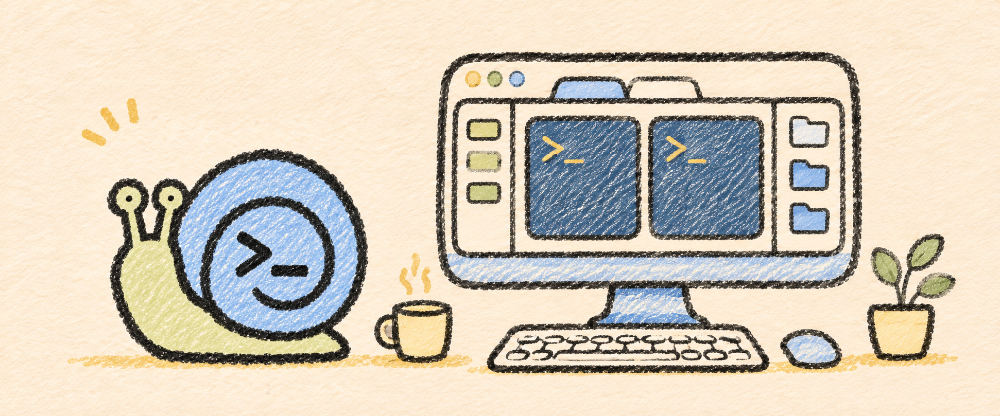

<p align="center">
  
</p>

<h1 align="center">ShellX</h1>

<p align="center">
  <strong>一个安静、顺手的 Mac 终端工作区。</strong><br>
  <sub>服务器侧栏 · 多标签 · 可调分屏 · 文件栏</sub><br><br>
  <sub>macOS 14+ · SwiftUI / AppKit · 可交互 Mock</sub>
</p>

从每天连接服务器、看日志、传文件的习惯出发，先把界面和交互打磨顺手。暖纸张、低饱和色彩、清晰的等宽文字，以及一只背着终端的蓝壳蜗牛。

**当前是本地 mock 客户端**：服务器、日志与文件均为示例；没有 SSH、SFTP、真实命令执行或文件传输。尚未提供正式安装包或自动更新。顶部配图为 imagegen 生成的概念插画，不是客户端截图。

## 先体验这几件事

- **找服务器**：搜索名称、地址、分组和用户名；搜索时展开结果，清空后恢复原来的折叠状态。
- **整理侧栏**：新增服务器和分组，组内快速添加；名称、地址和分组直接填写，用户名与端口按需展开。
- **切换工作**：点击服务器优先回到已有会话，也可另开标签；标签支持切换、关闭与拖动排序。
- **调整空间**：左右或上下分屏，拖动分割线调整比例，按需收起两侧栏。
- **浏览文件**：进入示例目录，选择文件或拖入本地文件，查看模拟传输状态。

服务器与分组编辑只在当前运行的内存中生效，重启恢复示例。侧栏显隐、宽度和分屏比例保存在本机偏好中。

<details>
<summary>本地构建</summary>

需要 macOS 14+ 与支持 Swift 5.10 的 Xcode / Swift 开发工具，Python 3 用于打包。

```sh
git clone https://github.com/anjing-le/anjing-shell.git
cd anjing-shell
bash scripts/preview.sh
```

生成 `dist/preview/ShellX.app` 并打开。预览采用本地 ad-hoc 签名，不需要付费开发者账号。仓库已包含原生图标资源；只有重建图标才需要 Xcode 27+。

终端可输入 `help` 查看固定的模拟命令；输入的内容不会传给系统 shell。公开源码使用系统指针回退，本机个人鼠标素材不随仓库分发。

</details>

<details>
<summary>常用快捷键</summary>

| 操作 | 快捷键 |
| --- | --- |
| 新建 / 关闭标签 | ⌘T / ⌘W |
| 左右 / 上下分屏 | ⌘D / ⌘⇧D |
| 切换标签 | ⌘⇧[ / ⌘⇧] |
| 服务器侧栏 / 文件栏 | ⌘B / ⌘⇧E |
| 设置 / 返回 | ⌘, / Esc |

搜索框中 Enter 打开首个结果，Esc 清空搜索；编辑面板中 Esc 关闭面板。

</details>

[开发与交互](docs/development.md) · [配图与来源](docs/artwork.md) · [createX](https://github.com/anjing-le/createX)
